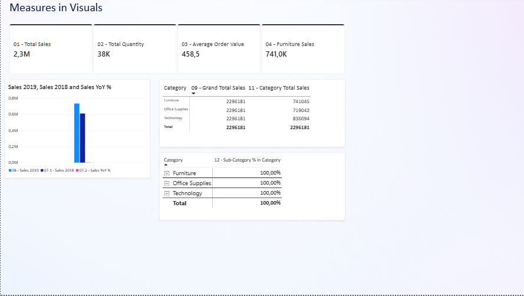

# 📈 Superstore Sales KPI Analysis with DAX

 

*A two-page report built around a dedicated **Measures Table** of 18+ DAX measures — from basic totals to YoY growth, ranking and contribution analysis.*

## 📸 Dashboard

---

## ❓ Business questions

- How did sales change year over year (2018 vs 2019)?
- What share does each sub-category contribute to its category?
- Which regions and states rank highest?
- What would sales look like after a 10% discount?

## 🗂 Data

Superstore sales data (**discountmart**) — category, sub-category, region, state, customer, sales, quantity.

## 📊 What's inside

- **Page 1:** total sales, quantity and average order value cards; Sales 2019 vs 2018 with **YoY %**; category / sub-category matrix with **% in category**
- **Page 2:** **Sales % of Total**, big-sales count and amount, sales after 10% discount, average sales per customer, **Top 3 sub-categories**, **Region and State rank**

## 🔢 Headline KPIs

| Total sales | Total quantity | Avg. order value | Furniture sales |
|:-:|:-:|:-:|:-:|
| **2.3M** | **38K** | **458.5** | **741K** |

## 💡 Key insights

- Sales grew from **2018 to 2019**, with the YoY % measure tracking the change.
- Sales are balanced across categories: **Technology 836K**, **Furniture 741K**, **Office Supplies 719K**.
- Every measure is stored in a dedicated, numbered **Measures Table**, making the model easy to audit and reuse.

## 🧠 Skills demonstrated

- Organized **Measures Table** with numbered, documented measures
- Time intelligence (YoY %)
- % of total and % of parent-category calculations
- Ranking measures for regions and states
- Top-N measure for best sub-categories
- Scenario measures (sales after discount)

---

## 🚀 How to open

1. Install [Power BI Desktop](https://www.microsoft.com/power-platform/products/power-bi/desktop) (free).
2. Download **`superstore-sales-kpi-dax.pbix`** from this repository.
3. Open it in Power BI Desktop and interact with the slicers and visuals.

---

Built by <a href="https://github.com/Ali-Isa-Ashrafli"><b>Ali Isa Ashrafli</b></a> · Data Analyst · Baku, Azerbaijan 
⭐ If you find this project useful, consider giving it a star!

